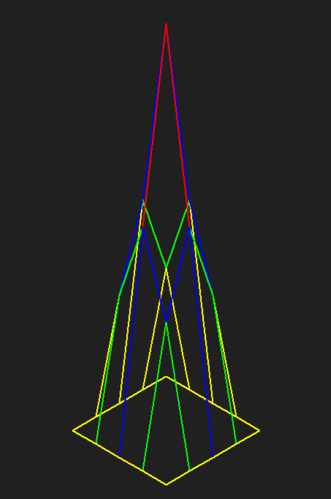

FdF — 3D-карта высот.
Описание проекта:
Программа предназначена для отображения карт высот в виде трёхмерной каркасной модели. Она считывает данные из файла .fdf, определяет координаты и высоту точек и строит объёмное изображение с помощью изометрической проекции.

Возможности программы
* Чтение файлов формата .fdf.
* Поддержка отрицательных значений высоты.
* Поддержка цветов точек.
* Построение каркасной модели из линий.
* Автоматическое масштабирование и центрирование карты.
* Перерисовка при изменении размера окна.
* Приближение и отдаление колёсиком мыши.
* Обработка ошибок при чтении файла.
* Закрытие программы клавишей Esc.

Скриншот программы - 

Требования
* Python 3.12 или новее.
* Tkinter.

Для проверки программы используются pytest, Ruff и mypy.

Установка:
Создать виртуальное окружение: python -m venv .venv
Активировать его: .venv\Scripts\Activate.ps1
Установить инструменты для проверки: python -m pip install pytest mypy ruff

Запуск программы
Из корневой папки проекта выполнить команду: python main.py maps/example.fdf
Для запуска другой карты нужно указать путь к соответствующему файлу .fdf.

Управление
Действие - Управление
Приблизить карту - Колёсико мыши прокрутить вверх
Отдалить карту - Колёсико мыши прокрутить вниз
Закрыть программу - Esc

Формат файла карты:
Файл .fdf содержит значения высоты точек. Каждая строка соответствует строке карты, а каждое значение — отдельной точке.
Цвет указывается после запятой в формате 0xRRGGBB. Он является необязательным.

Пример:
0 1,0xFF0000 2
1 2 3
2 3 4

Программа поддерживает отрицательные значения высоты и проверяет правильность формата файла.

Структура проекта

fdf-python/
├── fdf/
│   ├── __init__.py
│   ├── app.py
│   ├── errors.py
│   ├── model.py
│   ├── parser.py
│   ├── projection.py
│   └── render.py
├── maps/
│   ├── example.fdf
│   └── mountain.fdf
├── tests/
│   ├── test_parser.py
│   ├── test_projection.py
│   └── test_render.py
├── docs/
│   └── screenshot.png
├── main.py
└── README.md

* app.py — графическое окно и отображение карты.
* errors.py — классы ошибок.
* model.py — точки и модель карты.
* parser.py — чтение и проверка файлов.
* projection.py — преобразование координат.
* render.py — построение рёбер каркасной модели.
* main.py — запуск программы.
* maps/ — примеры карт.
* tests/ — автоматические тесты.
* docs/ — скриншот программы.

Проверка программы

Запуск тестов: python -m pytest -q

Проверка оформления кода: ruff check .

Проверка типов: mypy --strict fdf main.py

Итог
В результате создана программа для загрузки и отображения карт высот в виде трёхмерной каркасной модели. Реализованы обработка ошибок, поддержка цветов, управление масштабом и автоматические тесты.

[def]: docs/screenshot.png